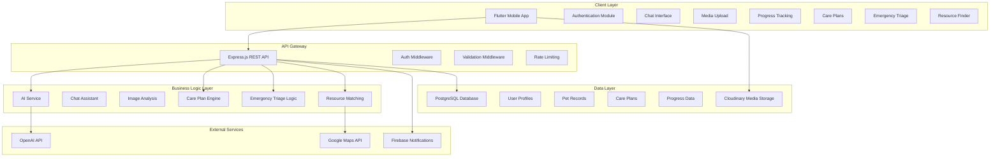

# First-Time Pet Owner Support App - Technical Architecture

## Project Overview
A comprehensive mobile application designed to provide real-time guidance and support for new pet owners, featuring AI-powered assistance, visual health assessments, progress tracking, personalized care plans, emergency triage, and local resource discovery.

## Technology Stack

### Frontend (Mobile App)
- **Framework**: Flutter
  - Cross-platform development for iOS and Android
  - Excellent performance for image/video processing
  - Rich UI components and animations
  - Strong community support

### Backend
- **Runtime**: Node.js
- **Framework**: Express.js
- **Database**: PostgreSQL
  - Structured data storage for user profiles, pet records, schedules
  - ACID compliance for data integrity
  - Advanced querying capabilities

### Cloud Services & APIs
- **AI/ML**: OpenAI GPT-4 API for conversational AI
- **Image/Video Storage**: Cloudinary
  - Secure media upload and processing
  - CDN for fast content delivery
  - Image analysis capabilities
- **Maps & Geolocation**: Google Maps API
- **Push Notifications**: Firebase Cloud Messaging
- **Authentication**: JWT tokens

### Development Tools
- **Version Control**: Git
- **API Documentation**: Swagger/OpenAPI
- **Testing**: Jest (backend), Flutter Test (frontend)
- **CI/CD**: GitHub Actions
- **Containerization**: Docker

## System Architecture



## Database Schema Design

### Users Table
```sql
- id (UUID, Primary Key)
- email (VARCHAR, Unique)
- password_hash (VARCHAR)
- first_name (VARCHAR)
- last_name (VARCHAR)
- phone (VARCHAR)
- location_lat (DECIMAL)
- location_lng (DECIMAL)
- city (VARCHAR)
- country (VARCHAR)
- created_at (TIMESTAMP)
- updated_at (TIMESTAMP)
```

### Pets Table
```sql
- id (UUID, Primary Key)
- user_id (UUID, Foreign Key)
- name (VARCHAR)
- species (VARCHAR) - dog, cat, bird, etc.
- breed (VARCHAR)
- birth_date (DATE)
- weight (DECIMAL)
- gender (VARCHAR)
- profile_image_url (VARCHAR)
- created_at (TIMESTAMP)
- updated_at (TIMESTAMP)
```

### Health_Records Table
```sql
- id (UUID, Primary Key)
- pet_id (UUID, Foreign Key)
- record_type (VARCHAR) - weight, vaccination, checkup, etc.
- value (DECIMAL)
- unit (VARCHAR)
- notes (TEXT)
- media_urls (JSON)
- created_at (TIMESTAMP)
```

### Care_Plans Table
```sql
- id (UUID, Primary Key)
- pet_id (UUID, Foreign Key)
- plan_type (VARCHAR) - feeding, exercise, training, etc.
- title (VARCHAR)
- description (TEXT)
- frequency (VARCHAR)
- custom_parameters (JSON)
- is_active (BOOLEAN)
- created_at (TIMESTAMP)
- updated_at (TIMESTAMP)
```

### Appointments_Reminders Table
```sql
- id (UUID, Primary Key)
- user_id (UUID, Foreign Key)
- pet_id (UUID, Foreign Key)
- title (VARCHAR)
- description (TEXT)
- scheduled_for (TIMESTAMP)
- reminder_type (VARCHAR) - feeding, medication, vet visit, etc.
- is_completed (BOOLEAN)
- created_at (TIMESTAMP)
```

### Local_Resources Table
```sql
- id (UUID, Primary Key)
- name (VARCHAR)
- category (VARCHAR) - vet, pet store, groomer, etc.
- address (TEXT)
- location_lat (DECIMAL)
- location_lng (DECIMAL)
- phone (VARCHAR)
- website (VARCHAR)
- rating (DECIMAL)
- price_range (VARCHAR)
- verified (BOOLEAN)
```

## API Endpoints Design

### Authentication
- `POST /api/auth/register` - User registration
- `POST /api/auth/login` - User login
- `POST /api/auth/refresh` - Refresh JWT token
- `POST /api/auth/logout` - User logout

### Pets
- `GET /api/pets` - Get user's pets
- `POST /api/pets` - Add new pet
- `GET /api/pets/:id` - Get pet details
- `PUT /api/pets/:id` - Update pet information
- `DELETE /api/pets/:id` - Delete pet

### Health & Progress
- `GET /api/pets/:id/health-records` - Get health records
- `POST /api/pets/:id/health-records` - Add health record
- `GET /api/pets/:id/weight-tracker` - Get weight history
- `POST /api/pets/:id/weight-tracker` - Log weight

### AI Assistant
- `POST /api/ai/chat` - Send message to AI assistant
- `POST /api/ai/analyze-image` - Analyze pet photo/video
- `POST /api/ai/emergency-triage` - Get emergency assessment

### Care Plans
- `GET /api/pets/:id/care-plans` - Get pet's care plans
- `POST /api/pets/:id/care-plans` - Create care plan
- `PUT /api/care-plans/:id` - Update care plan
- `DELETE /api/care-plans/:id` - Delete care plan

### Local Resources
- `GET /api/resources/nearby` - Find nearby resources
- `GET /api/resources/search` - Search resources
- `GET /api/resources/:id` - Get resource details

### Reminders
- `GET /api/reminders` - Get user reminders
- `POST /api/reminders` - Create reminder
- `PUT /api/reminders/:id` - Update reminder
- `DELETE /api/reminders/:id` - Delete reminder

## Key Features Implementation Details

### 1. Conversational AI Support
- Integration with OpenAI GPT-4 API
- Context-aware conversations about pet care
- Specialized prompts for pet health and behavior
- Conversation history persistence

### 2. Visual Assessment
- Image/video upload to Cloudinary
- AI analysis using computer vision models
- Health condition detection
- Behavior analysis from video content

### 3. Progress Tracking
- Weight tracking with visual charts
- Feeding schedule management
- Milestone tracking (vaccinations, training achievements)
- Data visualization using Flutter charts

### 4. Personalized Care Plans
- Dynamic plan generation based on pet profile
- Budget-aware recommendations
- Location-specific considerations
- Adaptive learning from user feedback

### 5. Emergency Triage
- Symptom-based assessment flow
- Urgency level classification
- Immediate action recommendations
- Emergency contact integration

### 6. Local Resource Finder
- Geolocation-based search
- Category filtering (vets, stores, groomers)
- User reviews and ratings
- Price range and availability information

## Security Considerations

### Authentication & Authorization
- JWT-based authentication
- Role-based access control
- Secure password hashing (bcrypt)
- Session management

### Data Protection
- End-to-end encryption for sensitive data
- GDPR compliance for user data
- Secure file upload validation
- API rate limiting

### Privacy
- User consent for data processing
- Anonymized analytics
- Data retention policies
- Right to data deletion

## Performance Optimization

### Frontend
- Lazy loading for images and content
- State management optimization
- Caching strategies
- Code splitting

### Backend
- Database query optimization
- API response caching
- Image compression and CDN
- Database indexing

## Deployment Strategy

### Backend
- Docker containerization
- Cloud deployment (AWS/Azure)
- Load balancing
- Auto-scaling configuration

### Mobile App
- App Store deployment
- Play Store deployment
- Over-the-air updates
- A/B testing framework

## Monitoring & Analytics

### Application Monitoring
- Error tracking and logging
- Performance metrics
- User behavior analytics
- API usage monitoring

### Business Metrics
- User engagement rates
- Feature adoption statistics
- Retention analysis
- Support ticket trends

## Future Enhancements

1. **Multi-language Support** - Expand beyond English
2. **Wearables Integration** - Connect with pet fitness trackers
3. **Community Features** - Pet owner social network
4. **Veterinary Telemedicine** - Video consultations with vets
5. **Pet Insurance Integration** - Insurance marketplace
6. **Smart Home Integration** - Connected pet feeders and monitors